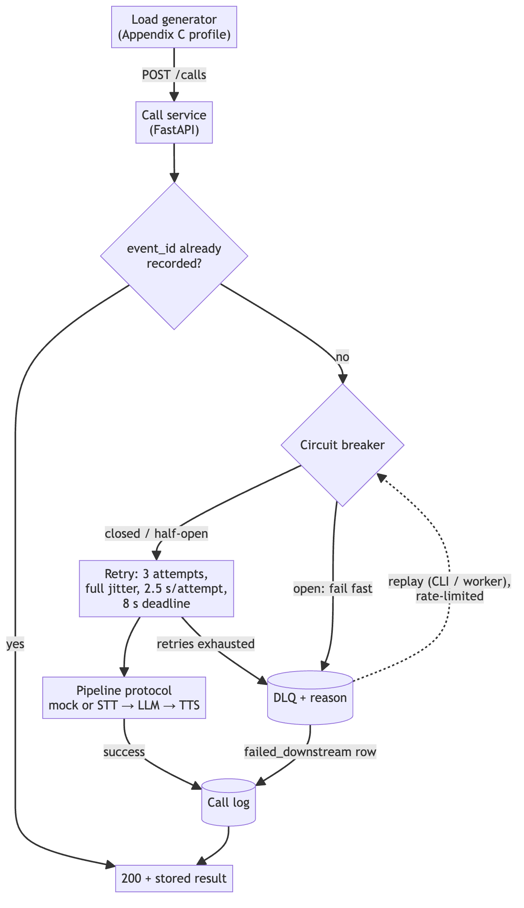
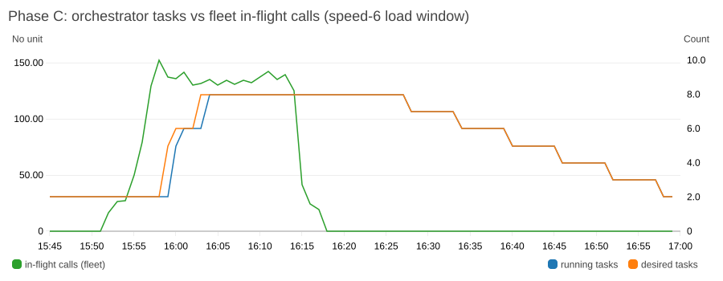
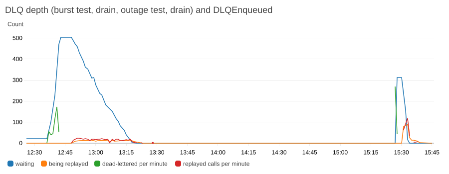
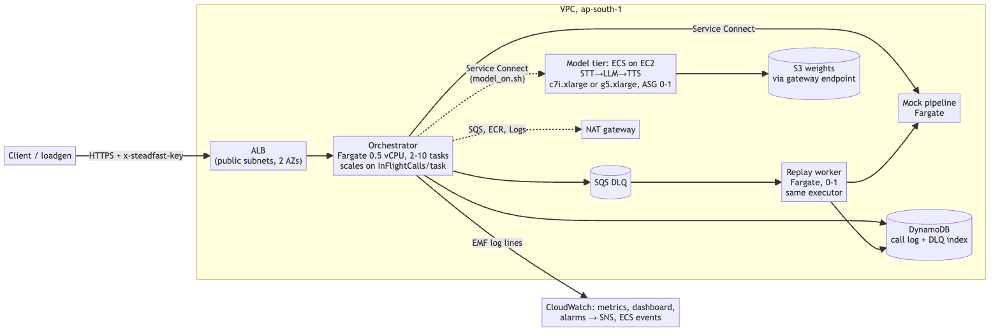

# Steadfast

Steadfast guarantees **zero unaccounted collections calls** on a flaky open-weight
STT → LLM → TTS pipeline. Every call event ends in one of two places:
- the call log, with its outcome;
- a dead-letter queue (DLQ), with the reason it failed, from which it can be inspected and
  replayed.

It never ends nowhere: a dropped, unlogged collections call is a compliance gap, not just a
bad user experience. Retries with full jitter absorb the dependency's normal 20% failure
rate. A circuit breaker fails fast when the dependency is really down. Every result is
persisted before the caller is told "done".

The same service runs locally (Round 1) and on AWS in ap-south-1 (Round 2): ECS Fargate,
custom-metric autoscaling, CloudWatch, and a real open-weight model tier.

| | Calls | Unaccounted |
|---|---|---|
| Local, 20% injected failures | 6,083 | **0** |
| Local, correlated outage bursts / mock killed mid-run | 6,083 / 6,086 | **0 / 0** |
| AWS, a full campaign window with autoscaling (2 → 8 → 2 tasks) | 6,083 | **0** |
| AWS, real open-weight models at 4× overload | 1,037 | **0** |

Contents:
- [How a call flows](#how-a-call-flows)
- [Quick start (Round 1, local)](#quick-start-round-1-local)
- [See the failure handling yourself](#see-the-failure-handling-yourself)
- [Design decisions](#design-decisions)
- [Results](#results)
- [Configuration](#configuration)
- [Round 2: AWS](#round-2-aws-ap-south-1)
- [Limitations and next steps](#limitations-and-next-steps)
- The docs in [docs/](docs/):
  - [COST.md](docs/COST.md): cost estimate and recommendation;
  - [MODEL_SWAP.md](docs/MODEL_SWAP.md): swapping in a real model;
  - [RUNBOOK.md](docs/RUNBOOK.md);
  - [DESIGN.md](docs/DESIGN.md);
  - [aws/model-tier.md](docs/aws/model-tier.md).

## How a call flows



Source: [docs/diagrams/call-flow.mmd](docs/diagrams/call-flow.mmd) (Mermaid).

`POST /calls` answers 200 only once the outcome is written, and that includes a failed
call that was dead-lettered. It answers 500 only if the call could not be recorded, so the
client knows to resend. Replays go through the same executor, so they get the same retries,
breaker and persistence.

## Quick start (Round 1, local)

**Prerequisites:**
- Docker with Compose v2;
- `make`;
- Python 3.12 (only for `make venv`, which the tests, lint and AWS scripts need).

No cloud account is needed.

```bash
cp .env.example .env    # optional: every value is the default, none are secrets
make up                 # build and start the mock pipeline + call service, wait for healthy
make venv && make test  # unit + integration tests (pytest)
make load-window        # campaign window 07:45-10:15 at speed 60: 6,083 calls in 2.5 min
make burst              # same window, mock in burst mode (15 s total outage every 60 s)
make dlq-list           # inspect what was dead-lettered, with reasons
make dlq-replay         # replay it through the normal executor (RATE=20/s by default)
make down
```

How the load commands work:
- Every load target ends with a report written to `results/run-<UTC timestamp>.json`.
- The report looks up every `event_id` it sent and **exits non-zero if any call is
  unaccounted**.
- Speed 60 means 1 simulated hour = 1 real minute.
- `make help` lists every target.

Two things to expect:
- **Run load tests on an otherwise idle machine.** CPU starvation shows up as attempt
  timeouts, which the breaker rightly counts as failures. A run made while a headless
  browser was busy on the same laptop opened the breaker once and dead-lettered 10.7%,
  though still with 0 unaccounted.
- **Some replays fail again.** Replayed calls face the same 20% failure rate, so about
  0.8% stay `replay_failed`, and `make dlq-replay` then exits 1. Run it again to retry
  just those.

## See the failure handling yourself

| To see | Run | What to look for |
|---|---|---|
| Retries absorbing 20% independent failures | `make load-window` | Report shows ~80% `succeeded_first_try`, ~19% after retry, ~1% DLQ (all `retries_exhausted`), no breaker transitions, `unaccounted: 0` |
| The circuit breaker opening on correlated failure | `make burst` | `breaker_opens` > 0; most DLQ entries have reason `circuit_open` (fast-failed, not retried into a dead mock) |
| A full outage, then recovery | `make outage` | The mock is stopped 40 s into the run and restarted 30 s later. Then the DLQ is replayed: `dlq stats` shows the backlog `replayed`, apart from ~0.8% that fail again and can be replayed once more |
| One dead letter in full | `docker compose exec service python -m service.cli dlq show <event_id>` | The original payload, reason, attempts and timestamps |
| Breaker transitions as they happen | `make logs` (in a second terminal) | JSON lines with `"event": "breaker_transition"` |
| Kill the dependency by hand | `make kill-mock`, then `make start-mock` | Calls keep returning 200 with `failed_downstream` and land in the DLQ |

## Design decisions

| Decision | Value | Why |
|---|---|---|
| Attempts per call | 3 | At a 20% independent failure rate, 0.2³ = **0.8%** of calls reach the DLQ. The measured figure was 0.72% |
| Backoff | full jitter, base 0.2 s, cap 2 s | When many calls fail at once, fixed backoff retries them in synchronised waves. Full jitter spreads them out |
| Per-attempt timeout / call deadline | 2.5 s / 8 s | 2.5 s is about 1.8× the mock's p99 (1.42 s). The deadline bounds how long a borrower can wait, whatever the attempt count |
| Breaker | opens at **50%** failures over a **full 100-attempt window**; 10 s open; 3 half-open probes | Normal failure is 20%, so the trip point must sit well above the noise (details below) |
| Persist before ack | SQLite WAL, `synchronous=FULL` | "Recorded" means fsynced before the 200. WAL lets `/stats` and `/dlq` read during writes |
| Idempotency | by `event_id` | A repeated or concurrent event returns the stored result without calling the pipeline. Replay upserts the same row |
| Failure ordering | DLQ entry, then call-log row | If the second write fails, the event is still replayable |

The first breaker design used a 20-attempt window and a 10-attempt minimum. It flapped:
- In simulation, it opened about **18 times a day on pure noise**, because 5 failures in
  the first 10 attempts is a ~3% event.
- The end-to-end test opened it at a true 20% failure rate in half of its runs. Failures
  return instantly while successes take ~300 ms, so a fresh window starts out
  failure-heavy.

A full 100-attempt window removes both effects. A real outage still opens the breaker
within 50 failed attempts of a healthy window (`tests/test_breaker.py`). Half-open probes
are judged together: one success closes the circuit, and only all-failed reopens it. The
reasoning is in `service/resilience/breaker.py`.

**Latency spec note.** Appendix B suggests `lognormvariate(5.7, 0.35)` for targets of
p50 ≈ 300 ms, p90 ≈ 700 ms and p99 ≈ 1200 ms. That sigma is too narrow for those targets.
`make check-latency` (10,000 samples, seed 42) gives:

| sigma | p50 ms | p90 ms | p99 ms |
|---|---|---|---|
| target | 300 | 700 | 1200 |
| 0.35 (spec) | 298 | 472 | 683 |
| 0.60 | 297 | 655 | 1231 |
| **0.66 (used)** | 297 | 708 | 1419 |

The mock uses **0.66**, which matches p50 and p90 and errs pessimistic at p99, so the
timeouts are tested against a fatter tail than the spec's. Set `LATENCY_SIGMA=0.35` to use
the literal spec.

## Results

All runs replay the Appendix C morning campaign window (07:45–10:15, ramp 10 → 50
calls/min), seed 42 unless noted. The files are in `results/`.

**Round 1, local** (speed 60, 2.5 real minutes):

| Run | Sent | 1st try | After retry | DLQ (reasons) | DLQ % | p50 / p95 / p99 ms | Breaker opens | Unaccounted |
|---|---|---|---|---|---|---|---|---|
| Independent 20% (`run-20261025T124726Z`) | 6,083 | 4,876 | 1,163 | 44 (all `retries_exhausted`) | 0.72 | 361 / 971 / 1,437 | 0 | **0** |
| Burst mode (`run-20261025T125040Z`) | 6,083 | 3,161 | 725 | 2,197 (2,139 `circuit_open`, 58 exhausted) | 36.1 | 285 / 1,015 / 1,818 | 4 | **0** |
| Mock killed mid-run, seed 7 (`run-20261025T131906Z`) | 6,086 | 3,237 | 740 | 2,109 (2,057 `circuit_open`, 52 exhausted) | 34.7 | 238 / 807 / 1,250 | 4 | **0** |

How to read these:
- **Burst and outage latency is lower, not higher.** While the breaker is open, calls fail
  in milliseconds instead of waiting out three attempts against a dead mock.
- **The outage run's DLQ was replayed afterwards:** all 2,109 entries ended `replayed`.
- **A fresh clone reproduced these results** on 2026-10-26: independent 0.97% DLQ with no
  breaker transitions; burst 35.5% DLQ with 4 opens; 0 unaccounted in both. Its replay of
  2,809 entries left 21 `replay_failed` (0.75%) for a second pass.

**Round 2, AWS** (2 Fargate tasks behind an ALB). The orchestrator ran with
`TURNS_PER_CALL=6` and `TURN_GAP_S=5`, so each call is a 6-turn conversation of ~27 s, and
calls in flight are large enough to drive autoscaling. The expected per-call rates follow:
- all 6 turns succeed first time with probability 0.8⁶ = 26%;
- at least one turn exhausts its retries with probability 1 − 0.992⁶ = 4.7%.

| Run | Sent | 1st try | After retry | DLQ (reasons) | DLQ % | p50 / p99 ms | Unaccounted |
|---|---|---|---|---|---|---|---|
| Short window, speed 6 (`run-20261026T120822Z`) | 605 | 164 | 419 | 22 (exhausted) | 3.6 | 27,405 / 29,546 | **0** |
| Burst mode (`run-20261026T123707Z`) | 605 | 30 | 94 | 481 (304 `circuit_open`) | 79.5 | 11,304 / 29,160 | **0** |
| Mock scaled to 0 (`run-20261026T152709Z`) | 312 | 0 | 0 | 312 (243 `circuit_open`) | 100 | 124 / 696 | **0** |
| Full window, speed 6, autoscaling (`run-20261026T155219Z`) | 6,083 | 1,640 | 4,165 | 278 (exhausted) | 4.6 | 27,461 / 29,670 | **0** |
| Real models (CPU), speed 1 (`run-20261026T194118Z`) | 1,037 | 219 | 163 | 655 (163 `circuit_open`) | 63.2 | 833 / 27,056 | **0** |

Notes on the AWS runs:
- **Measured rates match the expectation:** 27.0% first try and 4.57% DLQ in the full
  window.
- **Replay on AWS drained every DLQ:**
  - the burst run's backlog of 504 (481 plus 23 left over from the short window), then the
    outage run's 312, then the full window's 278;
  - 1,094 replayed in total, **0 replay failures**.
- **The model run was at 4× overload, by design.** One CPU instance serves ~13 calls/min
  against a 50/min peak. It degraded by rejecting fast and dead-lettering, never by losing
  calls ([details](docs/aws/model-tier.md)). That run's 655 dead letters were not replayed
  before teardown.





## Configuration

Every setting is an environment variable. They are read from the shell or a local `.env`;
`.env.example` documents each one and none are secrets. On AWS, Terraform sets them per
service.

| Variable | Default | Purpose |
|---|---|---|
| `PIPELINE_BACKEND` | `mock` | `mock` or `open_weight`: which implementation sits behind the `Pipeline` protocol |
| `PIPELINE_URL` | `http://localhost:8081` | Where the pipeline lives (compose sets `http://mock:8081`) |
| `HTTP_MAX_CONNECTIONS` | `50` | Connection pool to the pipeline. Oversizing it costs event-loop time at peak |
| `CALL_LOG_BACKEND` / `DLQ_BACKEND` | `sqlite` / `sqlite` | `dynamodb` / `sqs` on AWS (shared by every task) |
| `AWS_REGION` | `ap-south-1` | AWS backends only |
| `CALL_LOG_TABLE` / `DEAD_LETTERS_TABLE` | `steadfast-call-log` / `steadfast-dead-letters` | DynamoDB tables |
| `SQS_QUEUE_URL` | (empty) | Required when `DLQ_BACKEND=sqs` |
| `DB_PATH` | `./data/steadfast.db` | SQLite file |
| `DB_SYNCHRONOUS` | `FULL` | `FULL` = fsync every commit (persist-before-ack); `NORMAL` = faster, may lose the last commits on power loss |
| `MAX_ATTEMPTS` | `3` | Pipeline attempts per call |
| `BACKOFF_BASE_S` / `BACKOFF_CAP_S` | `0.2` / `2.0` | Full-jitter backoff |
| `ATTEMPT_TIMEOUT_S` / `CALL_DEADLINE_S` | `2.5` / `8.0` | Per attempt, and per call |
| `BREAKER_WINDOW` / `BREAKER_MIN_CALLS` | `100` / `100` | Rolling window of attempts; minimum before judging |
| `BREAKER_FAILURE_THRESHOLD` | `0.5` | Failure ratio that opens the circuit |
| `BREAKER_OPEN_S` / `BREAKER_HALF_OPEN_MAX` | `10` / `3` | Time open before probing; probes per half-open round |
| `TURNS_PER_CALL` / `TURN_GAP_S` | `1` / `0` | Pipeline turns per call (1 = the spec; AWS demo uses 6 and 5 s) |
| `OUTCOME_SEED` | (empty) | Seed for business-outcome sampling |
| `SHUTDOWN_DRAIN_S` | `15` | How long shutdown waits for in-flight calls to be persisted |
| `LOG_LEVEL` | `INFO` | |
| `METRICS_BACKEND` | `prometheus` | `prometheus` (`GET /metrics`) or `emf` (CloudWatch, namespace `CollectionsChallenge`) |
| `SERVICE_NAME` / `GAUGE_INTERVAL_S` | `steadfast-orchestrator` / `10` | EMF dimension; how often in-flight/breaker gauges are published |
| `REPLAY_RATE_PER_S` / `REPLAY_CONCURRENCY` | `5` / `8` | Replay worker (AWS) rate and parallel receive loops |
| `FAILURE_RATE` | `0.2` | Mock: injected 503 rate |
| `LATENCY_MU` / `LATENCY_SIGMA` | `5.7` / `0.66` | Mock: lognormal latency in ms (see the latency note) |
| `SEED` | (empty) | Mock: seed for reproducible behaviour |
| `FAILURE_MODE` | `independent` | Mock: `independent` or `burst` |
| `BURST_ON_S` / `BURST_OFF_S` | `15` / `45` | Mock burst mode: outage length, then healthy gap |
| `STEADFAST_URL` | `http://localhost:8080` | CLI and load generator target |
| `STEADFAST_API_KEY` / `STEADFAST_CA_BUNDLE` | (empty) | AWS only, set by `eval "$(scripts/aws_env.sh)"`: access key header and pinned ALB certificate |

The AWS scripts also read the variables below; `.env.example` explains each:
- `AWS_PROFILE`
- `IMAGE_TAG`
- `AUTO_APPROVE`
- `BUILD_NETWORK`
- `TF_VAR_alert_email`
- `MAX_WAIT_S`
- `MINUTES`

## Round 2: AWS (ap-south-1)



Source: [docs/diagrams/aws-architecture.mmd](docs/diagrams/aws-architecture.mmd) (Mermaid).

What the deployment consists of:
- **Network:** tasks run in private subnets. DynamoDB and S3 are reached through free
  gateway endpoints; everything else leaves through one NAT gateway.
- **IAM:** no wildcard actions ([DESIGN.md](docs/DESIGN.md)).
- **Metrics:** they leave the tasks as Embedded Metric Format log lines, so no task needs
  `cloudwatch:PutMetricData`.
- **Repeatability:** everything is Terraform in `infra/` plus scripts in `scripts/`. There
  are no console steps.

**Prerequisites:**
- An AWS account with billing enabled.
- AWS CLI v2 with a profile for it.
- Terraform ≥ 1.6.
- Docker with `buildx`.
- Python 3.12 (`make venv`).
- `curl`.
- Quotas in ap-south-1: Fargate 8 vCPU. For the model tier, also 6 standard on-demand vCPU
  (a c7i.xlarge model host plus a c7i.large image builder). For the GPU tier, "Running
  On-Demand G and VT instances" ≥ 4 (Appendix G).

**Deploy:**

```bash
export AWS_PROFILE=<your profile> AWS_REGION=ap-south-1
export TF_VAR_alert_email=<you@example.com>   # optional; AWS emails a confirmation link to click
make venv
make aws-deploy      # ECR, build + push images (tag = git SHA), terraform apply; asks before applying
make aws-smoke       # 403 without the key, health, readiness, one call recorded and looked up
terraform -chdir=infra output -raw dashboard_url
```

**Demo** (watch the [recorded video on YouTube](https://youtu.be/T3inVZCFdRs)):

```bash
make aws-load-window       # 07:45-10:15 at speed 6 (25 min): tasks 2 -> 8 -> 2; exits 1 if any call is unaccounted
make aws-replay            # drain the DLQ through the replay worker, then stop it
scripts/model_on.sh cpu    # build the model image in AWS, upload weights, start the model tier (or: gpu)
SPEED=1 START=07:55 HOURS=0.5 LABEL=model-e WAIT_SCALE_IN=0 scripts/load_aws.sh   # real models, 20% faults
scripts/model_off.sh
make aws-results LABEL=demo   # export CloudWatch series to results/
```

Burst mode on AWS:
- Run `TF_VAR_mock_failure_mode=burst make aws-deploy`.
- Afterwards, deploy again **without** the variable to return the mock to independent
  failures. If you exported it, `unset TF_VAR_mock_failure_mode` first.

Outage drill: scale `steadfast-mock` to 0 and back (see the
[runbook](docs/RUNBOOK.md#procedures)).

**Teardown (end of every session):**

```bash
scripts/teardown.sh   # model off, terraform destroy, then asks AWS directly what is left
```

It writes `results/teardown.log` and `results/teardown-verify.txt`, with the account ID
redacted. The last run ended `RESULT: PASS`.

Operations, alarms, log queries, rollback and escalation are in
[docs/RUNBOOK.md](docs/RUNBOOK.md).

## Repository layout

| Path | What |
|---|---|
| `service/` | Call service. The resilience layer is in `resilience/` (retry, breaker, executor); stores are in `store/` (SQLite, DynamoDB, SQS); the `Pipeline` protocol and implementations are in `pipeline/` |
| `mock/` | Appendix B mock pipeline (latency, 20% failures, burst mode) |
| `loadgen/` | Appendix C traffic generator and the unaccounted-call report |
| `model/` | Open-weight model server (faster-whisper, llama.cpp, Piper) |
| `infra/` | Terraform for the AWS deployment |
| `scripts/` | Deploy, load, replay, model on/off, results export, teardown and verification |
| `tests/` | pytest suite (AWS backends tested with moto) |
| `results/` | Every run report and CloudWatch export cited above |
| `docs/` | Cost, model swap, runbook, design, model-tier measurements |

## Limitations and next steps

- **The GPU tier is untested.** The account's G-instance quota was 0. The image stage, AMI
  and Terraform path exist; only the CPU tier ran.
- **The model tier is a single instance and is not autoscaled.** The 50 calls/min peak
  needs about 4 CPU instances or a GPU. Next steps:
  - scale the model tier on its queue depth or 429 rate;
  - make the model log its own rejections. Today the 429 / queue-timeout / fault breakdown
    is inferred from the orchestrator's side.
- **Turn-level latency alarm.** Measures per-turn `TurnLatencyMs` EMF metric (excluding
  inter-turn silence) with baselines configured per backend (~1,450 ms for mock, ~6,000 ms
  for CPU tier), ensuring `steadfast-latency-p99` fires reliably under failure.
- **Calling hours enforcement.** Both outbound campaigns and DLQ replays respect RBI's
  permissible calling hours (`08:00–19:00 IST`) via `REPLAY_CALLING_WINDOW` in
  `service/config.py`, deferring replays when outside permitted windows.
- **Native ECS Blue/Green Deployments.** Zero-downtime deployments with a 2-minute bake
  period, synthetic pre-shift verification via `x-steadfast-green: 1`, and automated
  CloudWatch alarm rollbacks (`scripts/bluegreen_demo.sh`).
- **Multi-AZ Availability Zone Rebalancing.** `availability_zone_rebalancing = "ENABLED"`
  with clean connection draining. Verified via `scripts/az_drill.sh` with 0 client 5xx errors
  and 0 unaccounted calls during AZ loss.
- **Breakers are per task.** Outage detection slows as tasks are added. A fleet-wide hint
  could open them together ([DESIGN.md](docs/DESIGN.md)).
- **This is demo-grade, by design.** Production would change:
  - one NAT gateway → one per AZ;
  - a self-signed certificate and a single shared key → ACM with a domain and per-client
    credentials;
  - local Terraform state → an S3 backend with locking;
  - call log and DLQ deleted with the stack → retained.
- **Future work:** Indic-language models for Indian languages (candidates documented in
  [DESIGN.md](docs/DESIGN.md#ap-south-1-notes)).

## Licence

Apache-2.0, see [LICENSE](LICENSE). The models used are MIT, Apache-2.0 or public domain
([details](docs/aws/model-tier.md)).
