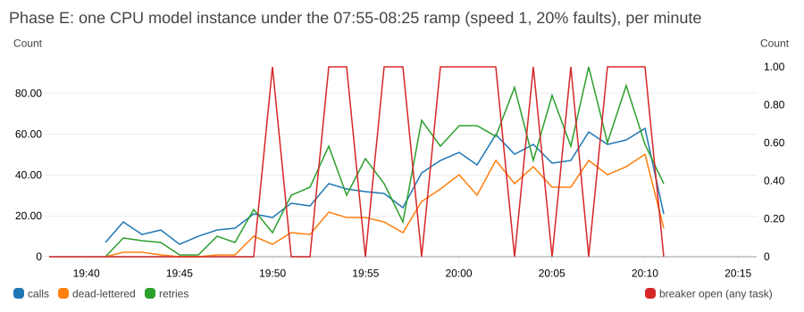

# Model tier on AWS (Round 2, Phase D)

The orchestrator talks to an open-weight STT -> LLM -> TTS server (`model/`) over the same
`POST /pipeline/process` contract as the mock, via Service Connect (`http://model:8080`).
Switch it on and off with `scripts/model_on.sh [cpu|gpu]` and `scripts/model_off.sh`.

## What runs

| Stage | CPU tier (tested) | GPU tier (untested, see below) | Licence |
|---|---|---|---|
| STT | faster-whisper `small`, int8 | faster-whisper `large-v3-turbo`, int8_float16 | MIT |
| LLM | Qwen2.5-1.5B-Instruct Q4_K_M (llama.cpp) | Mistral-7B-Instruct-v0.3 Q4_K_M | Apache-2.0 |
| TTS | Piper 2023.11.14-2, voice `en_US-ljspeech-medium` | same | MIT; voice data public domain (LJ Speech) |
| Host | c7i.xlarge (4 vCPU, 8 GiB) | g5.xlarge (A10G) | |

Licence notes:
- Piper is the MIT release, not the later GPL `piper1-gpl` fork. It links espeak-ng
  (GPL-3.0), so it runs as a separate process (`model/stages.py`), never imported.
- The Hindi Piper voices are CC BY-NC-SA (non-commercial), so they are not used.
- llama-cpp-python is MIT. PyAV is BSD and its bundled FFmpeg is LGPL, dynamically linked.

## Measured latency (single sequential calls, 20% fault injection on)

`scripts/model_latency.py` sends sequential calls through the public ALB and aggregates
the orchestrator's `model_turn` log events with Logs Insights. On c7i.xlarge:

| | p50 | p99 |
|---|---|---|
| STT | 1.57 s | 1.76 s |
| LLM (max 80 tokens) | 1.98 s | 4.90 s |
| TTS | 0.31 s | 1.30 s |
| Whole attempt, seen by the orchestrator | 3.9 s | 7.8 s |

Source: `results/model-latency-20261026T192604Z.json` (40 calls, all succeeded, 6
injected faults retried); re-checked after tuning in `results/model-latency-20261026T193710Z.json`.

## Timeouts derived from it

| Setting | Value | Why |
|---|---|---|
| `ATTEMPT_TIMEOUT_S` | 16 s | about 2x the attempt p99 (7.8 s) |
| model `QUEUE_TIMEOUT_S` | 8 s | queue wait + p99 turn stays under 16 s: the model rejects (retryable 503) before the orchestrator gives up, so it never computes an answer nobody waits for |
| `CALL_DEADLINE_S` | 50 s | 3 attempts plus backoff, and under the ALB's 60 s idle timeout so the client always gets the recorded result |
| model admission | 1 in progress, 4 queued | one turn uses all 4 vCPUs; beyond the queue it answers 429 at once instead of slowing every call |

Throughput of one instance is therefore about 16 turns per minute.

## Load test against one instance (Phase E)

`SPEED=1 START=07:55 HOURS=0.5 LABEL=model-e WAIT_SCALE_IN=0 scripts/load_aws.sh`:
real-time traffic from 5 minutes of baseline (10 calls/min) through the 15-minute ramp
to the 50 calls/min peak, with 20% fault injection, against a single CPU model instance.

| | |
|---|---|
| sent | 1037 |
| succeeded (first try / after retry) | 382 (219 / 163) |
| dead-lettered | 655 (492 retries exhausted, 163 rejected while the breaker was open) |
| HTTP errors | 0 |
| **unaccounted** | **0** |

The instance serves about 13 calls per minute (16 turns per minute, minus attempts lost to
injected faults), so by 08:00 demand already exceeds it. What the run shows is the
behaviour at 4x overload: the model rejects at once (429) instead of letting latency
grow without bound, and the orchestrator retries and then opens its breaker instead of
piling on. Every call that cannot be served ends up in the DLQ with a reason, ready to
replay (Phase B showed replay drains the queue). Serving the peak needs about 4 model
instances, or the GPU tier.

Source: `results/run-20261026T194118Z.json`, `results/aws-model-e-20261026T201146Z.json`.

## Deviations from the plan, and why

- **c7i.xlarge instead of c7i.2xlarge:** the account's standard on-demand quota is 8 vCPU,
  shared with an unrelated instance.
- **GPU tier untested:** the G-instance quota is 0 (increase requested). The code path,
  AMI and image stage exist but have not run.
- **The image is built in AWS, not on the laptop** (`scripts/build_model.sh`,
  `infra/build.tf`): a one-shot EC2 instance builds, pushes and terminates. Locally,
  Docker downloads ran at ~30 kB/s and the image is ~1 GB. CodeBuild was tried first,
  but the account's CodeBuild concurrency quota is 0.
- **llama-cpp-python is compiled for CPU** in a build stage: the prebuilt CPU wheels link
  against musl and fail on Debian (glibc). The Dockerfile imports every module at build
  time, so this kind of error fails the build, not the deployment.
- **The AWS account had to move from the Free plan to a paid plan:** the Free plan only
  allows a few small instance types, which ruled out both the c7i.xlarge host and the
  builder.
