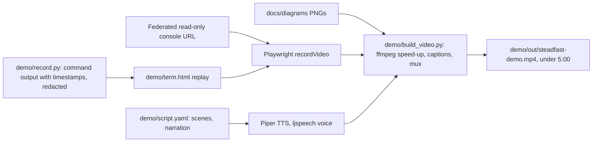

# Steadfast Round 2: finish everything except the GPU tier

Work runs in phases, per CLAUDE.md. At the end of each phase I list the files changed, the commands to run and what to verify. Every `terraform apply` is shown to you for approval first, and the session always ends with `scripts/teardown.sh` reporting PASS.

## Phase 1: code fixes (local, no AWS)

- **Latency alarm that can actually fire.**
  - Add a per-turn EMF metric `TurnLatencyMs` in [service/metrics_emf.py](service/metrics_emf.py), emitted from the turn loop in [service/resilience/executor.py](service/resilience/executor.py). A turn includes its retries and backoff but not `TURN_GAP_S`.
  - Point `steadfast-latency-p99` in [infra/alarms.tf](infra/alarms.tf) at p99 of `TurnLatencyMs`, firing above 3 × `baseline_turn_p99_ms`.
  - The baseline is chosen per `pipeline_target`: about 1,450 ms for the mock (measured p99 1,437) and about 6,000 ms for the CPU model tier. The thresholds become about 4.4 s and 18 s, both reachable under the call deadline.
  - Keep the 5xx alarm unchanged.
- **Replay respects calling hours.**
  - New setting `REPLAY_CALLING_WINDOW` (default `08:00-19:00`, timezone `Asia/Kolkata`; empty disables the gate) in [service/config.py](service/config.py).
  - [service/replay.py](service/replay.py) and [service/replay_worker.py](service/replay_worker.py) skip or defer replays outside the window and log `replay_deferred`.
  - Document the setting in `.env.example` and add unit tests.
- **The model logs its own rejections.** [model/app.py](model/app.py) logs `model_rejected` with the reason (`overloaded`, `queue_timeout`, `downstream_timeout`, `warming_up`, `model_error`). The model image's content hash changes, so `model_on.sh` rebuilds it in AWS automatically.
- Verify: `make lint && make test`. New tests cover the turn metric, the calling-window gate and the window edge cases.

## Phase 2: Terraform, provider 6.x and native blue/green

- [infra/versions.tf](infra/versions.tf): change `~> 5.80` to `~> 6.x` (the minimum version with ECS native blue/green, confirmed with `terraform providers schema`), then `terraform init -upgrade` and fix any v6 breaking changes.
- [infra/orchestrator.tf](infra/orchestrator.tf):
  - add a second ("green") target group;
  - set `deployment_configuration { strategy = "BLUE_GREEN", bake_time_in_minutes = 2 }`;
  - set `load_balancer.advanced_configuration` with the alternate target group, the production listener rule and a test listener rule. The test rule matches header `x-steadfast-green: 1`, so green can be tested before the traffic shift;
  - add alarm-based rollback using the 5xx and latency alarms;
  - set `availability_zone_rebalancing = "ENABLED"`.
- New IAM role for ECS to manage the ALB during the shift ([infra/iam.tf](infra/iam.tf)). It is written out with explicit actions (`elasticloadbalancing:ModifyListener`, `ModifyRule`, `DescribeListeners`, `DescribeRules`, `DescribeTargetGroups`, `DescribeTargetHealth`), not the AWS managed policy, which uses wildcard actions. Describe-only actions get `Resource "*"` with a comment explaining why.
- Verify: `terraform fmt -check`, `terraform validate` and `terraform plan` against the empty account (no cost). CI is pinned to Terraform 1.17.0, so it stays green.

## Phase 3: scripts

- `scripts/az_drill.sh`: during a load run, stop every orchestrator task in one AZ (`ecs list-tasks`, then `describe-tasks` filtered by `availabilityZone`, then `stop-task`), wait for recovery, and print ALB 5xx and running tasks per AZ. Pass means loadgen `http_errors = 0` and `unaccounted = 0`.
- `scripts/bluegreen_demo.sh`:
  - (a) Deploy a new image tag through blue/green. Show green tasks starting, test traffic through the `x-steadfast-green` header, the bake time, then the shift.
  - (b) Deploy a deliberately broken revision (`CALL_LOG_TABLE` pointing at a missing table, so `/ready` fails). Show green never taking production traffic and the automatic rollback.
- `scripts/aws_costs.py`: Cost Explorer `get-cost-and-usage`, daily, grouped by SERVICE and USAGE_TYPE, for the session dates. It excludes the unrelated faultline t3.small, its EIP and its EBS by usage type, and writes `results/costs-<date>.json` with the account ID redacted. For the recording session, apply with `activate_cost_allocation_tag = true` so costs can be filtered by `Project=steadfast`.

## Phase 4: video tooling (`demo/`, output gitignored)

- `requirements-demo.txt`: playwright (Apache-2.0), using the Chromium already cached in `~/Library/Caches/ms-playwright`.
- **Voice-over:** the Piper 2023.11.14-2 macOS x64 binary (MIT), downloaded to `demo/.tools/` (gitignored), with the `en_US-ljspeech-medium` voice (public domain) already in `model-weights/cpu/`. If the binary fails on macOS, fall back to macOS `say`.
- **Console capture:**
  - `demo/console_url.py` calls `sts get-federation-token` for the IAM user, with a read-only session policy (CloudWatch, ECS, autoscaling, logs and SQS reads), and gets a sign-in URL. The URL lives in memory only.
  - Playwright opens the `steadfast` dashboard with a 10 s auto-refresh. It hides the account menu with injected CSS, and ffmpeg crops the top bar as a second safeguard.
- **Terminal capture:** `demo/record.py` runs each demo command, redacts the account ID, access key and email, and saves timestamped lines. `term.html` replays them with typing effects at a chosen speed.
- **Composition:** `demo/build_video.py` sets each scene's length to the longer of its narration and its clip, speeds long clips up (the 25-minute load window at about 20×, with an on-screen "20× speed" label), burns in captions, and outputs 1080p H.264 with AAC audio.
- **Storyboard (about 5:00):**
  - 0:00 title and architecture;
  - 0:20 deploy and smoke test (403 without the key, one recorded call);
  - 0:50 load window on the dashboard (tasks 2 → 8 → 2, `unaccounted: 0`);
  - 2:00 DLQ inspect and replay drain;
  - 2:30 outage drill (alarm fires) and multi-AZ drill;
  - 3:10 blue/green: test header, shift, bad-revision rollback;
  - 3:40 CPU open-weight models with 20% faults and model rejections;
  - 4:30 teardown, verify PASS;
  - 4:50 cost and close.

## Phase 5: AWS test session (about 1 h, ~$1)

Deploy, then confirm each new piece works before recording:
- blue/green good and bad deploys;
- the AZ drill;
- the latency alarm firing during the outage drill;
- a short console capture, checked frame by frame for any 12-digit account ID.

Fix whatever breaks, then tear down and confirm PASS.

## Phase 6: AWS recording session (about 2.5 h, ~$2-3)

Run the storyboard's scenes in order, with all captures recording. Export `make aws-results LABEL=demo` and the costs, run `scripts/teardown.sh`, and commit the new `results/` files (teardown log and verification, run reports, cost export).

## Phase 7: build and verify the video

- `demo/build_video.py`, then `ffprobe` must report 5:00 or less.
- Privacy and quality checks:
  - extract a frame every 5 s and inspect the frames for account IDs, keys or email;
  - transcribe the final audio with the local faster-whisper small model and diff it against `script.yaml`.
- The video is not committed (it is too large). You upload it unlisted and give me the link.

## Phase 8: documentation, then mark done

- [docs/COST.md](docs/COST.md):
  - trim the Round 1 section to half a page;
  - fill "Round 2 measured" from `scripts/aws_costs.py`, giving per-service totals, cost per call and estimate-versus-actual.
- [README.md](README.md), [docs/RUNBOOK.md](docs/RUNBOOK.md) and [docs/DESIGN.md](docs/DESIGN.md):
  - blue/green deploy and rollback, which replace the image-tag rollback procedure;
  - the AZ drill procedure and its results;
  - the new latency alarm;
  - the calling-window gate;
  - an updated limitations list.
- `docs/ONE_PAGER.md`, plus a PDF printed with Playwright.
- [SUBMISSION.md](SUBMISSION.md): tick everything completed, with links.

## What stays with you

- Approving each `terraform apply`.
- Uploading the MP4 and sending me the link.
- After the October invoice is issued (early November): downloading the PDF from Billing → Bills and sending the reimbursement request. Until then, the measured costs come from Cost Explorer, and the receipt line stays open in SUBMISSION.md.
- The GPU tier, which is out of scope.